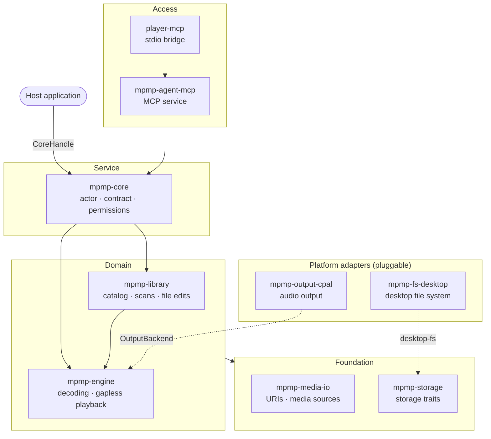

[中文](docs/zh-CN/README.md)

# mpmp core

The platform-independent Rust core of **mpmp** (*my personal music player*), a local music player: gapless playback, a SQLite music library, and one JSON contract shared by every client.

[](#license)
[](Cargo.toml)
[](docs/api-v1-freeze.md)

## Overview

mpmp core is the engine behind a player, not a player app. A host process embeds it, supplies an audio output, a way to open media sources, and storage, and talks to it through a `CoreHandle`. The core owns the play queue, play state, history, the music library, permissions, and the contract. User interfaces, system media controls, remote controls, and AI agents all use the same commands, queries, and events, either as typed Rust values or as JSON.

## Features

- **Playback**: FLAC, MP3, AAC/M4A, ALAC, Ogg Vorbis, WAV, and AIFF, decoded by [Symphonia](https://github.com/pdeljanov/Symphonia), with gapless transitions, resampling, ReplayGain and measured loudness, output device selection, stop-after-current, and a sleep timer. Opus is not decoded, including Opus in an Ogg container.
- **Signal path reporting**: each stage that touches the audio is reported, with a bit-perfect verdict of yes, no, or uncertain and its reasons.
- **Library**: SQLite catalog with folder scanning, CUE sheets, multi-artist tags, smart playlists, M3U import and export, lyrics, waveforms, play history, and ratings.
- **Safe file edits**: tag edits and embedded cover replacement use recoverable file replacement. Undoing and redoing a new tag edit restores the whole file byte for byte.
- **Undo journal**: library changes are recorded as actions that can be listed and undone.
- **One contract**: API 1.0 with a generated JSON Schema, normative guarantees, and golden examples. Each minor version is frozen.
- **Agent permissions**: every command has a default policy per origin, which the user can widen or narrow for each agent. Permanent deletion never happens without the user's confirmation. `player-mcp` connects MCP clients.

## Architecture

The workspace is layered. Crates depend only on their own layer and the layers below; platform adapters plug into the traits the lower layers define.



Solid arrows point from a crate to what it depends on; an arrow into a layer means the crates above use the crates of that layer. Dashed arrows are adapters: `mpmp-output-cpal` implements the engine's `OutputBackend`, and `mpmp-fs-desktop` implements the storage traits behind the default `desktop-fs` feature. The host supplies the adapters when it starts the core.

| Layer | Crate | Owns |
|---|---|---|
| Access | [`mpmp-mcp`](apps/player-mcp) | The `player-mcp` stdio bridge between MCP clients and the MCP service |
| Access | [`mpmp-agent-mcp`](crates/agent-mcp) | The MCP service for agents over a same-user Unix socket or named pipe |
| Service | [`mpmp-core`](crates/core) | The actor that owns queue, play state and history; the contract types; permissions and confirmations; `CoreHandle` |
| Domain | [`mpmp-library`](crates/library) | `Library`: the SQLite catalog, scans, CUE sheets, tags, covers, lyrics, playlists, the journal and undo, byte-exact tag undo |
| Domain | [`mpmp-engine`](crates/engine) | Decoding, gapless playback, resampling, loudness measurement, waveforms, signal path and bit-perfect reasoning, the `OutputBackend` trait and `NullOutput` |
| Foundation | [`mpmp-media-io`](crates/media-io) | Media URIs, the `SourceResolver` trait and `FileResolver`, byte sources shared by the engine and the library |
| Foundation | [`mpmp-storage`](crates/storage) | File, identity, space, and durable replacement traits used by the library |
| Adapter | [`mpmp-output-cpal`](crates/output-cpal) | An `OutputBackend` on cpal, shared mode only |
| Adapter | [`mpmp-fs-desktop`](crates/fs-desktop) | Windows, macOS, and Linux file system rules and location strings, behind `desktop-fs` |
| Example | [`mpmp-cli`](apps/cli) | A minimal gapless playback example on the engine (`mpmp-cli <file>...`) |
| Tests | [`mpmp-test-support`](crates/test-support) | Shared test backends and frozen client inputs, for tests only |

**Actor model.** `CoreHandle::start` spawns one actor thread that owns the queue, play state, history, and permission state. Clients hold a `CoreHandle`, which is cheap to clone. `execute` returns once the command's effects are visible. Queries read the published snapshot or the library's read connections without waiting for the actor. Events arrive on a channel in one core-wide `seq` order. The core stops on `shutdown` or when the last handle is dropped.

**Storage and platform boundary.** The engine knows nothing about libraries or platforms: output comes in as a `Box<dyn OutputBackend>` and media through a `SourceResolver`. The library and core reach the file system through the `mpmp-storage` traits and core's `Locations`. The default `desktop-fs` feature plugs in `mpmp-fs-desktop`. Without it, the host passes storage backends to `Library::open_with` and `Locations` in `CoreConfig.locations`; missing backends are refused before any I/O. `scripts/check-no-desktop-fs.sh` builds the core this way. See the [storage guide](docs/design/storage.md).

**Contract.** The contract types live in [`crates/core/src/contract/`](crates/core/src/contract), their semantics in [`guarantees.md`](crates/core/src/guarantees.md), and the generated schema in [`docs/contract.schema.json`](docs/contract.schema.json). See [Where the API is defined](#where-the-api-is-defined).

## Quick start

Requires Rust 1.90 or newer. On Linux, also install the ALSA development package (for example `libasound2-dev`).

```sh
git clone https://github.com/mpmp-music/core.git
cd core
cargo build --workspace --locked
cargo test --workspace --locked
```

Run the embedding example headless, optionally scanning a music folder:

```sh
cargo run -p mpmp-core --example embed -- ~/Music
```

Output for a folder with two tracks:

```text
API 1.0, state Stopped, 0 queue entries
scan: {"type":"completed","report":{"type":"scan","added_count":2,"updated_count":0,"restored_count":0,"removed_count":0,"error_count":0,"first_errors":[]}}
root: /home/me/Music (2 tracks)
{"request_id":2,"result":{"type":"ok","changed":true,"queue_revision":1795172246544}}
tracks in library: 2
```

The library lives in a temporary directory and is removed when the example exits. To play files on a real audio device, use the engine example: `cargo run -p mpmp-cli -- <file>...`.

## Usage

The crates are not published to crates.io. Depend on them through Git, pinned to a commit:

```toml
[dependencies]
mpmp-core = { git = "https://github.com/mpmp-music/core", rev = "<commit>" }
mpmp-engine = { git = "https://github.com/mpmp-music/core", rev = "<commit>" }
mpmp-library = { git = "https://github.com/mpmp-music/core", rev = "<commit>" }
mpmp-media-io = { git = "https://github.com/mpmp-music/core", rev = "<commit>" }
```

The snippets below are excerpts of [`crates/core/examples/embed.rs`](crates/core/examples/embed.rs), which runs with `cargo run -p mpmp-core --example embed`. The example needs the `desktop-fs` feature (on by default) because it opens the library with the default storage.

### Start a core

A core needs an output backend, a source resolver, and a catalog. `NullOutput` consumes audio without a device; a real host passes `mpmp_output_cpal::CpalBackend` or its own backend. Set `CoreConfig::state_file` to keep the queue and position across restarts.

```rust
use std::sync::Arc;
use std::time::Duration;

use mpmp_core::contract::{Command, CommandResult, Event, Origin, Query, QueryResult, Request};
use mpmp_core::{Catalog, CoreConfig, CoreHandle, SubscribeOptions};
use mpmp_engine::NullOutput;
use mpmp_engine::output::{SampleType, StreamFormat};
use mpmp_library::Library;
use mpmp_media_io::FileResolver;

fn main() -> Result<(), Box<dyn std::error::Error>> {
    let music = std::env::args_os().nth(1);

    // The library database; a real host keeps it in its data directory.
    let data = tempfile::tempdir()?;
    let library = Library::open(&data.path().join("library.db"))?;

    // NullOutput consumes audio at real-time pace without a device.
    let output = NullOutput::new(StreamFormat {
        sample_rate: 44_100,
        channels: 2,
        sample_type: SampleType::F32,
    });
    // Background loudness measurement is on by default; off keeps this example short.
    let config = CoreConfig {
        automatic_loudness_scan: Some(false),
        ..CoreConfig::default()
    };
    let core = CoreHandle::start(
        Box::new(output),
        Arc::new(FileResolver),
        Arc::new(library) as Arc<dyn Catalog>,
        config,
    )?;
```

### Subscribe, command, and query

`subscribe` returns a snapshot together with every later event, so a client never misses a change. `execute` takes a `Request` and the `Origin` the adapter assigns; `query` answers immediately. Work that takes long, such as a scan, runs as a job and ends with a `JobFinished` event.

```rust
    // A snapshot of the current state, then every event after it, in `seq` order.
    let options = SubscribeOptions::default().with_positions(false);
    let subscription = core.subscribe(Origin::Ui, options).ok_or("core stopped")?;
```

```rust
    if let Some(music) = music {
        // Typed command. The adapter, not the client, decides the origin.
        let path = std::path::absolute(music)?.to_string_lossy().into_owned();
        let request = Request {
            request_id: 1,
            idempotency_key: Some("embed-add-root".into()),
            command: Command::AddRoot { path },
        };
        let receipt = match core.execute(request, Origin::Ui).result {
            CommandResult::Ok(receipt) => receipt,
            CommandResult::Err { error } => return Err(format!("add_root: {error:?}").into()),
            _ => return Err("add_root: unknown result".into()),
        };
        // The scan runs as a job; its results are visible once its JobFinished arrives.
        let job = receipt.job.ok_or("folder is already in the library")?;
        for envelope in subscription.events.iter() {
            if let Event::JobFinished {
                job: id, outcome, ..
            } = envelope.event
                && id == job
            {
                println!("scan: {}", serde_json::to_string(&outcome)?);
                break;
            }
        }
    }

    // Typed query.
    if let QueryResult::Roots { roots } = core.query(Query::Roots) {
        for root in roots {
            println!("root: {} ({} tracks)", root.path, root.track_count);
        }
    }
```

### JSON and shutdown

Adapters for other languages and processes use `execute_json` and `query_json`. They apply the contract's strict parsing: unknown fields, unknown variants, and malformed input are answered with a contract error, never applied in part. `shutdown_with_result` waits for running jobs, the final state save, and the library to close.

```rust
    // The same contract as JSON, as adapters for other languages and processes send it.
    let response = core.execute_json(
        r#"{"request_id":2,"idempotency_key":null,"command":{"type":"set_shuffle","shuffle":true}}"#,
        Origin::Ui,
    );
    println!("{response}");
    let tracks = core.query_json(r#"{"type":"tracks","offset":0,"limit":0}"#);
    let tracks: serde_json::Value = serde_json::from_str(&tracks)?;
    println!("tracks in library: {}", tracks["total"]);

    // Wait for running jobs and the library to close before the process exits.
    core.shutdown_with_result(Duration::from_secs(10))?;
    Ok(())
}
```

The same `add_root` request as JSON, with its response:

```json
{"request_id":22,"idempotency_key":"ui-add-root-1","command":{"type":"add_root","path":"/home/me/Music"}}
{"request_id":22,"result":{"type":"ok","changed":true,"queue_revision":1792500000021,"root":3,"job":7,"action":5120}}
```

### Origins and permissions

Every command carries an `Origin`: `Ui`, `MediaControls`, `Remote { device }`, `Agent { name, session }`, or `System`. The adapter that received the request sets it; a client never chooses its own. Each command has a risk tier and a default policy per origin (allow, confirm, or forbidden). Agents authenticate with a token (`CoreHandle::authenticate_agent_connection`) and run under those defaults plus the grants the user gives them. A command that needs approval fails with `needs_confirmation` until the user answers through `Confirm` or `Reject` from the UI, and only UI subscribers receive `ConfirmationRequested`. Remotes cannot add or remove music folders. Retries are safe with an `idempotency_key`. See guarantees 5, 12, and 13 in [`guarantees.md`](crates/core/src/guarantees.md) and [permissions and agents](docs/design/agent-permissions.md).

### Agents over MCP

`player-mcp` is a stdio MCP server for agent clients such as Claude Code, Codex, and Gemini CLI. It connects to the MCP service a running host starts with `mpmp-agent-mcp`, only for the same OS user, and the agent's commands run as `Origin::Agent` under the permissions above.

```sh
cargo build --release -p mpmp-mcp --locked
```

See the [MCP setup guide](docs/agents/mcp-setup.md) for client configuration and diagnostics.

### Where the API is defined

| You need | Read |
|---|---|
| Rust types: `Command`, `Query`, `Request`, `Response`, `Event`, `ContractError`, and `CoreHandle` | [`crates/core/src/contract/`](crates/core/src/contract) and [`handle.rs`](crates/core/src/handle.rs); browse with `cargo doc -p mpmp-core --no-deps --open` |
| Behavior and guarantees (normative) | [`crates/core/src/guarantees.md`](crates/core/src/guarantees.md), also embedded in the rustdoc of `mpmp_core::contract` and in the schema's `description` |
| Message shapes, for clients in other languages | Golden examples in [`crates/core/tests/golden/current/`](crates/core/tests/golden/current): `request/`, `response/`, `query/`, `query_result/`, and `event/` |
| Validation and code generation | [`docs/contract.schema.json`](docs/contract.schema.json), generated from the Rust types; not meant for reading by hand |
| Versioning and compatibility | [Freeze policy](docs/api-v1-freeze.md) and [changes](docs/api-v1-changes.md) |

The frozen part of API 1.0 is the JSON wire format and the guarantees, not the Rust signatures.

## Status

- API **1.0**, database schema **1**, version **0.1.0**. This first public release is source only.
- Platforms: Windows, macOS, and Linux. Older development databases are handled as described in the [storage guide](docs/design/storage.md).

## Documentation

- Design notes: [permissions and agents](docs/design/agent-permissions.md), [queries, playlists, and undo](docs/design/queries-playlists-undo.md), [tags, CUE, covers, lyrics, and waveforms](docs/design/media-resources.md), [loudness and volume](docs/design/loudness-volume.md), [storage boundary](docs/design/storage.md), [platform checks](docs/design/platform-checks.md).
- Contract: [guarantees](crates/core/src/guarantees.md), [schema](docs/contract.schema.json), [freeze policy](docs/api-v1-freeze.md), [changes](docs/api-v1-changes.md), [golden examples](crates/core/tests/golden/README.md).
- Agents: [MCP setup](docs/agents/mcp-setup.md).

## Contributing

Bug reports, documentation fixes, and code are welcome. Read [CONTRIBUTING.md](CONTRIBUTING.md) first; AI coding agents should also read [AGENTS.md](AGENTS.md). Before submitting, run:

```sh
cargo fmt --all --check
cargo clippy --workspace --all-targets --locked -- -D warnings
cargo test --workspace --locked --no-fail-fast
bash scripts/check-no-desktop-fs.sh
bash scripts/check-long-lines.sh
```

## License

Licensed under either of [MIT](LICENSE-MIT) or [Apache-2.0](LICENSE-APACHE), at your option. Contributions are dual-licensed the same way. Third-party components and their licenses are listed in [THIRD-PARTY.md](docs/THIRD-PARTY.md) and [NOTICE](NOTICE).
