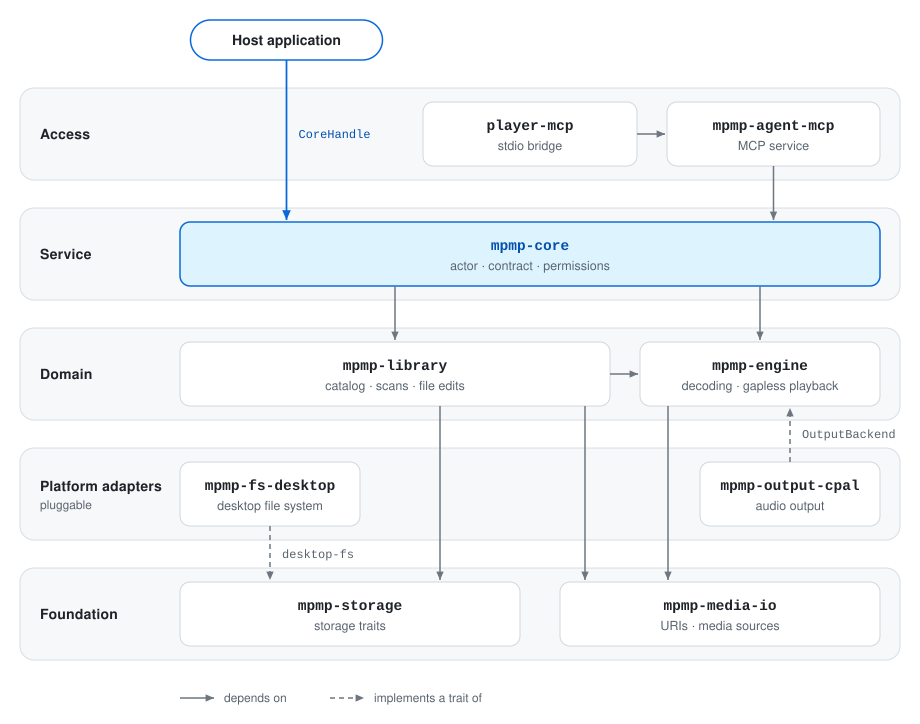

[English](../../README.md) · 本文为英文版的译文，如有出入以英文版为准。

# mpmp core

**mpmp**（*my personal music player*）是一款本地音乐播放器，本仓库是它与平台无关的 Rust 核心：无缝播放、SQLite 曲库，以及所有客户端共用的一份 JSON 契约。

[](#许可)
[][msrv]
[][api]

[msrv]: ../../Cargo.toml
[api]: api-v1-freeze.md

## 概述

mpmp core 是播放器背后的引擎，而不是一个播放器应用。宿主进程把它嵌入进来，提供音频输出、打开媒体源的方式和存储，再通过 `CoreHandle` 与它交互。核心负责播放队列、播放状态、播放历史、曲库、权限和契约。用户界面、系统媒体控制、远程控制和 AI Agent 使用同一套命令、查询和事件，既可以用带类型的 Rust 值，也可以用 JSON。

## 功能

- **播放**：FLAC、MP3、AAC/M4A、ALAC、Ogg Vorbis、WAV、AIFF，解码使用 [Symphonia](https://github.com/pdeljanov/Symphonia)；支持无缝切换、重采样、ReplayGain 与响度测量、输出设备选择、播完当前停止和睡眠定时。不解码 Opus，包括 Ogg 容器中的 Opus。
- **信号路径报告**：报告处理音频的每个环节，并给出是否 bit-perfect 的结论（是、否或不确定）及其原因。
- **曲库**：基于 SQLite，支持扫描文件夹、CUE、多艺术家标签、智能歌单、M3U 导入导出、歌词、波形、播放历史和评分。
- **安全的文件修改**：改标签和替换内嵌封面采用可恢复的文件替换。新标签编辑的撤销和重做会逐字节还原整份文件。
- **撤销日志**：曲库改动记录为操作，可以列出和撤销。
- **一份契约**：API 1.0，附生成的 JSON Schema、规范性语义保证和 golden 示例；每个小版本冻结。
- **Agent 权限**：每条命令按来源设有默认策略，用户可以为每个 Agent 放宽或收紧。永久删除必须经过用户确认。`player-mcp` 用于连接 MCP 客户端。

## 架构

工作区分层组织：crate 依赖本层和下面的层。平台适配层位于领域层和基础层之间：宿主把 `mpmp-output-cpal`（或其他 `OutputBackend`）传给核心，曲库和核心通过默认开启的 `desktop-fs` feature 使用 `mpmp-fs-desktop`。

<picture>
  <source media="(prefers-color-scheme: dark)" srcset="../images/architecture-dark.svg">
  
</picture>

实线箭头指向 crate 所依赖的对象；虚线箭头从适配指向它实现的 trait。

| 层 | Crate | 负责 |
|---|---|---|
| 接入 | [`mpmp-mcp`](../../apps/player-mcp) | MCP 客户端与 MCP 服务之间的 `player-mcp` stdio 桥 |
| 接入 | [`mpmp-agent-mcp`](../../crates/agent-mcp) | 面向 Agent 的 MCP 服务，经同一用户的 Unix socket 或命名管道提供 |
| 服务 | [`mpmp-core`](../../crates/core) | 持有队列、播放状态和历史的 actor；契约类型；权限与确认；`CoreHandle` |
| 领域 | [`mpmp-library`](../../crates/library) | `Library`：SQLite 曲库、扫描、CUE、标签、封面、歌词、歌单、操作日志与撤销、逐字节的标签撤销 |
| 领域 | [`mpmp-engine`](../../crates/engine) | 解码、无缝播放、重采样、响度测量、波形、信号路径与 bit-perfect 判断、`OutputBackend` trait 和 `NullOutput` |
| 基础 | [`mpmp-media-io`](../../crates/media-io) | 媒体 URI、`SourceResolver` trait 与 `FileResolver`，以及引擎和曲库共用的字节源 |
| 基础 | [`mpmp-storage`](../../crates/storage) | 曲库使用的文件、身份、空间和持久替换 trait |
| 适配 | [`mpmp-output-cpal`](../../crates/output-cpal) | 基于 cpal 的 `OutputBackend`，仅共享模式 |
| 适配 | [`mpmp-fs-desktop`](../../crates/fs-desktop) | Windows、macOS、Linux 的文件系统规则和位置字符串，位于 `desktop-fs` 之后 |
| 示例 | [`mpmp-cli`](../../apps/cli) | 基于引擎的最小无缝播放示例（`mpmp-cli <file>...`） |
| 测试 | [`mpmp-test-support`](../../crates/test-support) | 共享测试后端和冻结的客户端输入，仅供测试 |

**Actor 模型。** `CoreHandle::start` 启动一个 actor 线程，由它持有队列、播放状态、历史和权限状态。客户端持有 `CoreHandle`，克隆代价很低。`execute` 在命令的效果可见后返回。查询读取已发布的快照或曲库的只读连接，不等待 actor。事件通过 channel 按全核心统一的 `seq` 顺序送达。调用 `shutdown` 或丢弃最后一个 handle 时核心停止。

**存储与平台边界。** 引擎不了解曲库或平台：输出以 `Box<dyn OutputBackend>` 传入，媒体经 `SourceResolver` 打开。曲库和核心通过 `mpmp-storage` 的 trait 和核心的 `Locations` 访问文件系统。默认的 `desktop-fs` feature 接入 `mpmp-fs-desktop`。关闭它时，宿主要把存储后端传给 `Library::open_with`，并在 `CoreConfig.locations` 中提供 `Locations`；缺少后端会在任何 I/O 之前被拒绝。`scripts/check-no-desktop-fs.sh` 以这种方式构建核心。见[存储说明](design/storage.md)。

**契约。** 契约类型在 [`crates/core/src/contract/`](../../crates/core/src/contract)，语义在 [`guarantees.md`](../../crates/core/src/guarantees.md)，生成的 Schema 在 [`docs/contract.schema.json`](../contract.schema.json)。见 [API 在哪里定义](#api-在哪里定义)。

## 快速开始

需要 Rust 1.90 或更新版本。Linux 还需要安装 ALSA 开发包（例如 `libasound2-dev`）。

```sh
git clone https://github.com/mpmp-music/core.git
cd core
cargo build --workspace --locked
cargo test --workspace --locked
```

以无音频设备的方式运行嵌入示例，可以顺带扫描一个音乐文件夹：

```sh
cargo run -p mpmp-core --example embed -- ~/Music
```

一个含两首曲目的文件夹的输出：

```text
API 1.0, state Stopped, 0 queue entries
scan: {"type":"completed","report":{"type":"scan","added_count":2,"updated_count":0,"restored_count":0,"removed_count":0,"error_count":0,"first_errors":[]}}
root: /home/me/Music (2 tracks)
{"request_id":2,"result":{"type":"ok","changed":true,"queue_revision":1795172246544}}
tracks in library: 2
```

曲库放在临时目录中，示例退出时删除。要在真实音频设备上播放文件，请用引擎示例：`cargo run -p mpmp-cli -- <file>...`。

## 用法

这些 crate 没有发布到 crates.io。请通过 Git 依赖，并固定到某个 [release](https://github.com/mpmp-music/core/releases) tag：

```toml
[dependencies]
mpmp-core = { git = "https://github.com/mpmp-music/core", tag = "v0.1.0" }
mpmp-engine = { git = "https://github.com/mpmp-music/core", tag = "v0.1.0" }
mpmp-library = { git = "https://github.com/mpmp-music/core", tag = "v0.1.0" }
mpmp-media-io = { git = "https://github.com/mpmp-music/core", tag = "v0.1.0" }
```

工作区内所有 crate 共用一个版本，请把它们都固定到同一个 tag。想试用尚未发布的改动，可改用 `rev = "<commit>"`。

下面的代码片段摘自 [`crates/core/examples/embed.rs`](../../crates/core/examples/embed.rs)，可用 `cargo run -p mpmp-core --example embed` 运行。示例用默认存储打开曲库，因此需要 `desktop-fs` feature（默认开启）。

### 启动核心

核心需要一个输出后端、一个源解析器和一个曲库（catalog）。`NullOutput` 不需要设备就能消耗音频；真实宿主传入 `mpmp_output_cpal::CpalBackend` 或自己的后端。设置 `CoreConfig::state_file` 可以在重启后保留队列和播放位置。

```rust
use std::sync::Arc;
use std::time::Duration;

use mpmp_core::contract::{Command, CommandResult, Event, Origin, Query, QueryResult, Request};
use mpmp_core::{Catalog, CoreConfig, CoreHandle, SubscribeOptions};
use mpmp_engine::NullOutput;
use mpmp_engine::output::{SampleType, StreamFormat};
use mpmp_library::Library;
use mpmp_media_io::FileResolver;

fn main() -> Result<(), Box<dyn std::error::Error>> {
    let music = std::env::args_os().nth(1);

    // The library database; a real host keeps it in its data directory.
    let data = tempfile::tempdir()?;
    let library = Library::open(&data.path().join("library.db"))?;

    // NullOutput consumes audio at real-time pace without a device.
    let output = NullOutput::new(StreamFormat {
        sample_rate: 44_100,
        channels: 2,
        sample_type: SampleType::F32,
    });
    // Background loudness measurement is on by default; off keeps this example short.
    let config = CoreConfig {
        automatic_loudness_scan: Some(false),
        ..CoreConfig::default()
    };
    let core = CoreHandle::start(
        Box::new(output),
        Arc::new(FileResolver),
        Arc::new(library) as Arc<dyn Catalog>,
        config,
    )?;
```

### 订阅、命令与查询

`subscribe` 同时返回一份快照和之后的所有事件，客户端不会漏掉任何变化。`execute` 接收一个 `Request` 和适配器指定的 `Origin`；`query` 立即作答。扫描这类耗时的工作以 job 形式运行，结束时发出 `JobFinished` 事件。

```rust
    // A snapshot of the current state, then every event after it, in `seq` order.
    let options = SubscribeOptions::default().with_positions(false);
    let subscription = core.subscribe(Origin::Ui, options).ok_or("core stopped")?;
```

```rust
    if let Some(music) = music {
        // Typed command. The adapter, not the client, decides the origin.
        let path = std::path::absolute(music)?.to_string_lossy().into_owned();
        let request = Request {
            request_id: 1,
            idempotency_key: Some("embed-add-root".into()),
            command: Command::AddRoot { path },
        };
        let receipt = match core.execute(request, Origin::Ui).result {
            CommandResult::Ok(receipt) => receipt,
            CommandResult::Err { error } => return Err(format!("add_root: {error:?}").into()),
            _ => return Err("add_root: unknown result".into()),
        };
        // The scan runs as a job; its results are visible once its JobFinished arrives.
        let job = receipt.job.ok_or("folder is already in the library")?;
        for envelope in subscription.events.iter() {
            if let Event::JobFinished {
                job: id, outcome, ..
            } = envelope.event
                && id == job
            {
                println!("scan: {}", serde_json::to_string(&outcome)?);
                break;
            }
        }
    }

    // Typed query.
    if let QueryResult::Roots { roots } = core.query(Query::Roots) {
        for root in roots {
            println!("root: {} ({} tracks)", root.path, root.track_count);
        }
    }
```

### JSON 与关闭

其他语言和其他进程的适配器使用 `execute_json` 和 `query_json`。它们执行契约的严格解析：未知字段、未知变体和格式错误的输入都以契约错误作答，绝不只执行一部分。`shutdown_with_result` 会等待正在运行的 job、最后一次状态保存和曲库关闭。

```rust
    // The same contract as JSON, as adapters for other languages and processes send it.
    let response = core.execute_json(
        r#"{"request_id":2,"idempotency_key":null,"command":{"type":"set_shuffle","shuffle":true}}"#,
        Origin::Ui,
    );
    println!("{response}");
    let tracks = core.query_json(r#"{"type":"tracks","offset":0,"limit":0}"#);
    let tracks: serde_json::Value = serde_json::from_str(&tracks)?;
    println!("tracks in library: {}", tracks["total"]);

    // Wait for running jobs and the library to close before the process exits.
    core.shutdown_with_result(Duration::from_secs(10))?;
    Ok(())
}
```

同一个 `add_root` 请求的 JSON 形式及其响应：

```json
{"request_id":22,"idempotency_key":"ui-add-root-1","command":{"type":"add_root","path":"/home/me/Music"}}
{"request_id":22,"result":{"type":"ok","changed":true,"queue_revision":1792500000021,"root":3,"job":7,"action":5120}}
```

### 来源与权限

每条命令都带有一个 `Origin`：`Ui`、`MediaControls`、`Remote { device }`、`Agent { name, session }` 或 `System`。它由接收请求的适配器设置，客户端不能自己选择。每条命令有一个风险等级，并按来源设有默认策略（允许、确认或禁止）。Agent 用令牌认证（`CoreHandle::authenticate_agent_connection`），在这些默认策略加上用户给它的授权下运行。需要批准的命令会以 `needs_confirmation` 失败，直到用户在 UI 中通过 `Confirm` 或 `Reject` 作答；只有 UI 订阅者会收到 `ConfirmationRequested`。远程控制不能添加或移除音乐文件夹。带 `idempotency_key` 的请求可以安全重试。见 [`guarantees.md`](../../crates/core/src/guarantees.md) 中的第 5、12、13 条，以及[权限与 Agent](design/agent-permissions.md)。

### 通过 MCP 接入 Agent

`player-mcp` 是一个 stdio MCP 服务器，供 Claude Code、Codex、Gemini CLI 等 Agent 客户端使用。它连接到运行中的宿主用 `mpmp-agent-mcp` 启动的 MCP 服务，只限同一操作系统用户；Agent 的命令以 `Origin::Agent` 身份运行，受上述权限约束。

```sh
cargo build --release -p mpmp-mcp --locked
```

客户端配置和诊断见 [MCP 配置](agents/mcp-setup.md)。

### API 在哪里定义

| 需要了解 | 阅读 |
|---|---|
| Rust 类型：`Command`、`Query`、`Request`、`Response`、`Event`、`ContractError` 和 `CoreHandle` | [`crates/core/src/contract/`](../../crates/core/src/contract) 和 [`handle.rs`](../../crates/core/src/handle.rs)；可用 `cargo doc -p mpmp-core --no-deps --open` 浏览 |
| 行为与语义保证（规范性） | [`crates/core/src/guarantees.md`](../../crates/core/src/guarantees.md)，同时嵌入在 `mpmp_core::contract` 的 rustdoc 和 Schema 的 `description` 中 |
| 消息结构，供其他语言的客户端参考 | [`crates/core/tests/golden/current/`](../../crates/core/tests/golden/current) 中的 golden 示例：`request/`、`response/`、`query/`、`query_result/` 和 `event/` |
| 校验与代码生成 | [`docs/contract.schema.json`](../contract.schema.json)，由 Rust 类型生成，不适合直接阅读 |
| 版本与兼容性 | [冻结规则](api-v1-freeze.md)和[变更记录](api-v1-changes.md) |

API 1.0 冻结的是 JSON 线上格式和语义保证，而不是 Rust 签名。

## 当前状态

- API **1.0**，数据库 schema **1**，版本 **0.1.0**。首次公开只发布源码，见[发布说明](https://github.com/mpmp-music/core/releases/tag/v0.1.0)。
- 平台：Windows、macOS 和 Linux。较早的开发版数据库的处理方式见[存储说明](design/storage.md)。

## 文档

- 设计说明：[权限与 Agent](design/agent-permissions.md)、[查询、歌单与撤销](design/queries-playlists-undo.md)、[标签、CUE、封面、歌词与波形](design/media-resources.md)、[响度与音量](design/loudness-volume.md)、[存储边界](design/storage.md)、[平台验收](design/platform-checks.md)。
- 契约：[语义保证](../../crates/core/src/guarantees.md)、[Schema](../contract.schema.json)、[冻结规则](api-v1-freeze.md)、[变更记录](api-v1-changes.md)、[golden 示例](../../crates/core/tests/golden/README.md)。
- Agent：[MCP 配置](agents/mcp-setup.md)。

## 参与贡献

欢迎提交问题报告、文档修正和代码。请先阅读 [CONTRIBUTING.md](CONTRIBUTING.md)；AI 编码 Agent 还应阅读 [AGENTS.md](../../AGENTS.md)。提交前请运行：

```sh
cargo fmt --all --check
cargo clippy --workspace --all-targets --locked -- -D warnings
cargo test --workspace --locked --no-fail-fast
bash scripts/check-no-desktop-fs.sh
bash scripts/check-long-lines.sh
```

## 许可

使用者可任选 [MIT](../../LICENSE-MIT) 或 [Apache-2.0](../../LICENSE-APACHE)。贡献同样以这两种许可双重授权。第三方组件及其许可见 [THIRD-PARTY.md](../THIRD-PARTY.md) 和 [NOTICE](../../NOTICE)。
